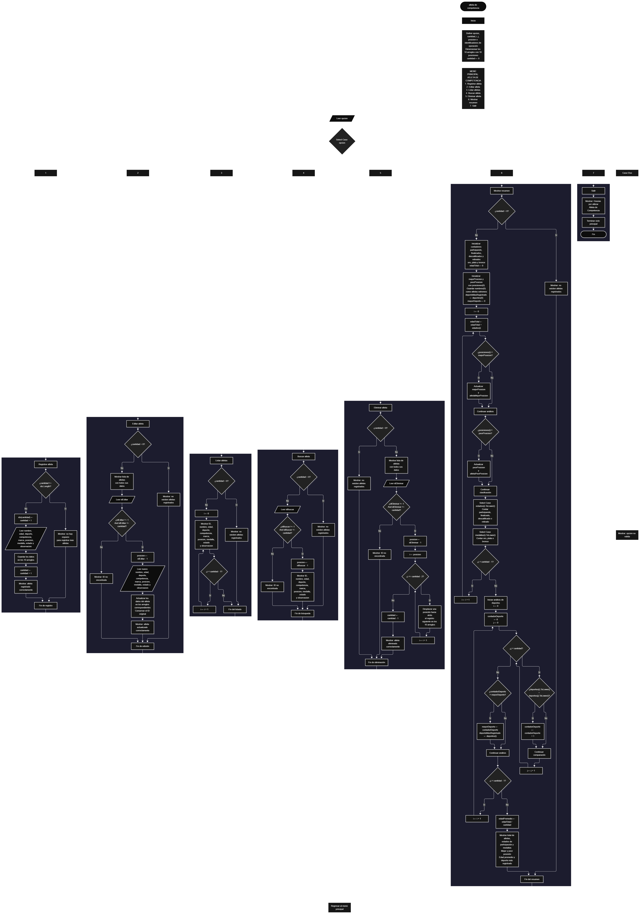

Este proyecto, llamado <b>atleta de competencia</b>, fue desarrollado en <b>visual basic .net</b> como un ejercicio práctico para fortalecer la lógica de programación mediante la creación de un sistema de gestión de atletas desde la consola. El programa cuenta con un menú principal de siete opciones que permite <b>registrar, editar, listar, buscar, eliminar y consultar estadísticas</b> de los atletas registrados. Cada atleta almacena información como el nombre, la edad, el deporte, la competencia, la marca, la posición, la medalla, el estado y las observaciones, utilizando arreglos con una capacidad máxima de <b>10 atletas durante la ejecución</b>. Durante su desarrollo se aplicaron conceptos fundamentales de programación, como variables, arreglos, estructuras condicionales, ciclos repetitivos y estructuras de selección, además de procesos para buscar, modificar, eliminar y organizar registros. También se implementaron cálculos estadísticos para conocer los estados de participación, las medallas obtenidas, las mejores y peores posiciones, la edad promedio y el deporte más registrado. Este proyecto permite poner en práctica los conocimientos adquiridos en Visual Basic .NET y sirve como base para desarrollar sistemas de gestión más avanzados utilizando otros lenguajes y tecnologías.

<h2 align="center">⚙️ Funcionamiento del menú principal</h2>

### ➕ Registrar atleta

La opción <b>1) registrar atleta</b> permite agregar un nuevo deportista al sistema. Antes de realizar el registro, el programa comprueba que la cantidad de atletas almacenados sea menor a la capacidad máxima de los arreglos, utilizando la condición <b>cantidad &lt; ids.Length</b>. Si existe espacio disponible, asigna automáticamente un identificador mediante la expresión <b>cantidad + 1</b> y solicita los datos del atleta: <b>nombre, edad, deporte, competencia, marca, posición, medalla, estado y observación</b>. Cada dato se almacena en la posición correspondiente de su respectivo arreglo. Finalmente, incrementa la variable <b>cantidad</b> en uno y muestra el mensaje <b>"Atleta registrado correctamente."</b>. Si se alcanza la capacidad máxima de 10 atletas, presenta el mensaje <b>"No hay espacio para registrar mas atletas."</b>, impidiendo agregar otro registro.

### ✏️ Editar atleta

La opción <b>2) editar atleta</b> permite modificar la información de un deportista registrado. Primero, el programa comprueba si existen atletas almacenados mediante la variable <b>cantidad</b>. Si no hay registros, muestra el mensaje <b>"No existen atletas registrados."</b>. En caso contrario, presenta una lista con la información de todos los atletas, incluyendo su ID, nombre, edad, deporte, competencia, marca, posición, medalla, estado y observación. Después, solicita el ID del atleta que se desea editar y comprueba que se encuentre dentro del rango permitido mediante la condición <b>idEditar &gt;= 1 And idEditar &lt;= cantidad</b>. Si la selección es válida, calcula su posición utilizando <b>idEditar - 1</b> y solicita los nuevos datos del atleta. La información se actualiza directamente en los arreglos correspondientes, conservando el identificador original. Finalmente, muestra el mensaje <b>"Atleta actualizado correctamente."</b>. Si el ID introducido no está dentro del rango permitido, presenta el mensaje <b>"ID no encontrada."</b>.

### 📋 Listar atletas

La opción <b>3) listar atletas</b> permite visualizar todos los deportistas registrados actualmente en el sistema. Antes de mostrar la información, el programa comprueba si la variable <b>cantidad</b> es igual a cero. Si no existen registros, presenta el mensaje <b>"No existen atletas registrados."</b>. Si hay atletas disponibles, utiliza un ciclo <b>For</b> para recorrer los arreglos desde la primera posición hasta la última posición ocupada. Durante el recorrido, muestra el ID, nombre, edad, deporte, competencia, marca, posición, medalla, estado y observación de cada atleta. Esta función facilita consultar todos los registros almacenados sin necesidad de buscar cada deportista individualmente.

### 🔎 Buscar atleta

La opción <b>4) buscar atleta</b> permite localizar un deportista mediante su identificador. Primero, el programa comprueba si existen atletas registrados. Si la cantidad es igual a cero, muestra el mensaje <b>"No existen atletas registrados."</b>. En caso contrario, solicita el ID del atleta que se desea buscar y verifica que esté dentro del rango permitido mediante la condición <b>idBuscar &gt;= 1 And idBuscar &lt;= cantidad</b>. Si el identificador es válido, calcula la posición correspondiente utilizando <b>idBuscar - 1</b> y muestra toda la información del atleta: <b>nombre, edad, deporte, competencia, marca, posición, medalla, estado y observación</b>. Si el ID introducido no corresponde a una posición dentro del rango establecido, presenta el mensaje <b>"ID no encontrada."</b>.

### 🗑️ Eliminar atleta

La opción <b>5) eliminar atleta</b> permite eliminar un deportista registrado mediante su identificador. Antes de comenzar, el programa comprueba que existan atletas almacenados. Si no hay registros, muestra el mensaje <b>"No existen atletas registrados."</b>. Si hay atletas disponibles, presenta una lista con toda su información. Después, solicita el ID del atleta que se desea eliminar y verifica que se encuentre dentro del rango permitido. Si el identificador es válido, calcula la posición del registro utilizando <b>idEliminar - 1</b> y comienza el proceso de eliminación. Para mantener organizados los datos, utiliza un ciclo <b>For</b> controlado por la variable <b>i</b>, que desplaza una posición hacia atrás los datos de los atletas posteriores en los diez arreglos: <b>ids, nombres, edades, deportes, competencias, marcas, posiciones, medallas, estados y observaciones</b>. Posteriormente, disminuye la variable <b>cantidad</b> en uno y muestra el mensaje <b>"Atleta eliminado correctamente."</b>. Si el ID introducido no está dentro del rango permitido, presenta el mensaje <b>"ID no encontrada."</b>.

### 📊 Mostrar resumen

La opción <b>6) mostrar resumen</b> permite consultar estadísticas generales de los atletas registrados. Primero, el programa comprueba si existen registros almacenados. Si la cantidad es igual a cero, muestra el mensaje <b>"No existen atletas registrados."</b>. En caso contrario, inicializa diferentes contadores para clasificar los estados de participación y las medallas obtenidas. Después, utiliza un ciclo <b>For</b> para recorrer los atletas, acumular sus edades, identificar la mejor y peor posición y contabilizar los estados y las medallas mediante estructuras <b>Select Case</b>. Para identificar el deporte más registrado, utiliza dos ciclos <b>For</b> anidados que comparan los deportes almacenados y cuentan cuántas veces aparece cada uno. Finalmente, calcula la edad promedio dividiendo la suma de las edades entre la cantidad de atletas y muestra un resumen con el total de atletas, los estados de participación, las medallas, los deportistas con mejor y peor posición, la edad promedio y el deporte más registrado. Esta opción permite obtener una visión general de los resultados y la participación de los atletas.

### 🚪 Salir del menú principal

La opción <b>7) salir</b> permite finalizar la ejecución del programa y muestra el mensaje <b>"Gracias por utilizar Atleta de Competencia."</b>. El menú principal se encuentra dentro de una estructura repetitiva <b>Do...Loop While</b>, que mantiene el programa en funcionamiento mientras la variable <b>opcion</b> sea diferente de <b>7</b>. Cuando el usuario selecciona esta opción, el programa ejecuta el mensaje de despedida y termina el ciclo repetitivo, finalizando la ejecución del sistema.

<h2 align="center">🧠 Temas aplicados en el proyecto</h2>

### 📦 Variables

En este proyecto se utilizan variables para controlar la cantidad de atletas registrados, almacenar la opción seleccionada en el menú, recorrer los arreglos, identificar la posición de un deportista, guardar los identificadores introducidos por el usuario y realizar los cálculos estadísticos. También se emplean variables auxiliares para contabilizar estados, medallas, edades y deportes, así como para identificar las mejores y peores posiciones de los atletas. Cada variable cumple una función específica dentro de las operaciones de gestión y análisis de la información.

🔢 **IdsEditar, IdBuscar e IdEliminar:** Almacenan el identificador del atleta que se desea editar, buscar o eliminar, respectivamente.

📊 **Cantidad:** Controla la cantidad actual de atletas registrados.

🔄 **Opcion:** Almacena la opción seleccionada por el usuario en el menú principal.

🔁 **I y J:** Funcionan como contadores para recorrer los arreglos y comparar los deportes durante el cálculo de estadísticas.

📍 **Posicion:** Almacena el índice correspondiente al atleta seleccionado mediante su identificador.

🏅 **Participando, Finalizados, Descalificados y Retirados:** Contabilizan los atletas según su estado de participación.

🥇 **Oro, Plata y Bronce:** Almacenan la cantidad de medallas obtenidas de cada categoría.

📈 **EdadTotal y EdadPromedio:** Permiten acumular las edades y calcular el promedio de los atletas registrados.

🏆 **MejorPosicion y PeorPosicion:** Almacenan los valores de las mejores y peores posiciones obtenidas.

👤 **AtletaMejorPosicion y AtletaPeorPosicion:** Guardan los nombres de los deportistas que tienen las posiciones extremas.

⚽ **DeporteMasRegistrado y MayorDeporte:** Permiten identificar el deporte que aparece con mayor frecuencia y almacenar su cantidad de registros.

🔢 **ContadorDeporte:** Cuenta las coincidencias de cada deporte durante el recorrido de los ciclos anidados.

### 🗃️ Arreglos

En este proyecto se utilizan diez arreglos paralelos para almacenar la información de los atletas registrados. Cada arreglo tiene una capacidad de <b>10 posiciones</b> y utiliza el mismo índice para representar los datos correspondientes a un mismo deportista. Por ejemplo, la información de un atleta almacenado en la posición <b>0</b> se encuentra distribuida entre <b>ids(0), nombres(0), edades(0), deportes(0), competencias(0), marcas(0), posiciones(0), medallas(0), estados(0) y observaciones(0)</b>. Esta organización permite recorrer, buscar, modificar, mostrar y eliminar los registros de manera ordenada.

🆔 **Ids(10):** Almacena los identificadores de los atletas registrados.

📝 **Nombres(10):** Almacena los nombres de los deportistas.

🎂 **Edades(10):** Almacena las edades de los atletas.

⚽ **Deportes(10):** Almacena los deportes practicados por cada atleta.

🏟️ **Competencias(10):** Almacena los nombres de las competencias en las que participan.

📏 **Marcas(10):** Almacena las marcas obtenidas por los deportistas.

🏆 **Posiciones(10):** Almacena las posiciones alcanzadas en las competencias.

🥇 **Medallas(10):** Almacena las medallas obtenidas por los atletas.

📌 **Estados(10):** Almacena los estados de participación de cada deportista.

📄 **Observaciones(10):** Almacena información adicional sobre cada atleta.

### 🔀 Estructuras condicionales

En este proyecto se utilizan las estructuras <b>If...Else</b> para comprobar si existen atletas registrados antes de ejecutar determinadas operaciones, verificar que haya espacio disponible durante el registro y validar los identificadores introducidos por el usuario. También se utilizan condiciones para determinar si una posición es mejor o peor que otra durante el cálculo de estadísticas y para identificar el deporte con mayor cantidad de registros. Estas comprobaciones permiten que el programa responda de manera diferente según la información almacenada y el resultado de cada operación.

### 🔄 Estructuras repetitivas

En este proyecto se utilizan las estructuras repetitivas <b>Do...Loop While</b> y <b>For</b>. El ciclo <b>Do...Loop While</b> mantiene activo el menú principal mientras el usuario no seleccione la opción de salida. Por otro lado, los ciclos <b>For</b> permiten recorrer los arreglos para mostrar los atletas registrados, consultar su información y desplazar los datos durante la eliminación de un deportista. También se utilizan ciclos anidados para comparar los deportes y determinar cuál se encuentra registrado con mayor frecuencia.

### 🎯 Estructura select case

El programa utiliza la estructura <b>Select Case</b> para evaluar la opción seleccionada por el usuario en el menú principal y ejecutar la operación correspondiente. Cada caso representa una función específica del sistema: <b>registrar, editar, listar, buscar, eliminar, mostrar resumen o salir</b>. También se utiliza <b>Case Else</b> para mostrar el mensaje <b>"Opcion no valida."</b> cuando el usuario introduce un número que no corresponde a las opciones disponibles. Adicionalmente, se emplea <b>Select Case</b> en el resumen para clasificar los estados de participación y las medallas obtenidas por los atletas.

### 🔢 Dimensionamiento de arreglos

El programa utiliza la declaración de arreglos con la dimensión <b>(9)</b> para establecer diez posiciones disponibles, desde el índice <b>0 hasta el 9</b>. Esta capacidad permite almacenar un máximo de <b>10 atletas</b> durante la ejecución del programa. La cantidad de registros ocupados se controla mediante la variable <b>cantidad</b>, mientras que la propiedad <b>ids.Length</b> permite comprobar la capacidad total disponible antes de registrar un nuevo deportista.

### 🔄 Reorganización de registros

Cuando se selecciona un atleta para eliminarlo, el programa utiliza un ciclo <b>For</b> que comienza en la posición seleccionada y llega hasta <b>cantidad - 2</b>. En cada repetición, los datos de la posición siguiente se copian sobre la posición actual en los diez arreglos. De esta manera, los registros posteriores ocupan las posiciones disponibles sin dejar espacios vacíos entre los atletas activos. Finalmente, la variable <b>cantidad</b> disminuye en uno. En el código actual, los identificadores no se renumeran después de esta reorganización, por lo que la correspondencia entre el ID y la posición del arreglo puede dejar de coincidir después de eliminar un registro.

### 📊 Contadores y acumuladores

El programa utiliza contadores y acumuladores para obtener las estadísticas de los atletas. Los contadores <b>participando, finalizados, descalificados y retirados</b> registran la cantidad de deportistas en cada estado, mientras que <b>oro, plata y bronce</b> contabilizan las medallas. La variable <b>edadTotal</b> acumula las edades para calcular el promedio. Por otro lado, <b>contadorDeporte</b> cuenta las coincidencias entre los nombres de los deportes durante los ciclos anidados, permitiendo determinar cuál tiene mayor frecuencia de registro.

### 🏅 Comparación de valores máximos y mínimos

Para identificar las mejores y peores posiciones, el programa inicializa las variables <b>mejorPosicion</b> y <b>peorPosicion</b> con la posición del primer atleta registrado. Después, recorre los registros y compara cada posición con los valores almacenados. Si encuentra una posición numéricamente menor, actualiza la mejor posición y el nombre del atleta correspondiente. Si encuentra una posición numéricamente mayor, actualiza la peor posición y el nombre del deportista. Así, el resumen identifica a los atletas que alcanzaron las posiciones extremas.

<h2 align="center">¿Cómo se implementaron las operaciones crud en el proyecto?</h2>

Las operaciones <b>crud</b> se implementaron mediante las opciones del menú principal, permitiendo administrar la información de los atletas registrados. La operación <b>crear</b> corresponde a <b>registrar atleta</b>, donde se introducen los datos de un nuevo deportista; <b>leer</b> se realiza mediante las opciones <b>buscar atleta, listar atletas y mostrar resumen</b>, que permiten consultar los registros y sus estadísticas; <b>actualizar</b> corresponde a <b>editar atleta</b>, donde se modifican los datos de un deportista existente; y <b>eliminar</b> se realiza mediante la opción <b>eliminar atleta</b>, que retira un registro y reorganiza los arreglos. Estas operaciones utilizan variables, arreglos, estructuras condicionales y ciclos para gestionar la información almacenada temporalmente durante la ejecución del programa.

<h2 align="center">Diagrama de flujo del proyecto</h2>

<h2 align="center">🛡️ Validaciones del programa</h2>

### 📭 No existen atletas registrados

Esta validación se utiliza en las opciones de <b>editar, listar, buscar, eliminar y mostrar resumen</b>. El programa comprueba si la variable <b>cantidad</b> es igual a <b>0</b> y, si no existen atletas registrados, muestra el mensaje <b>"No existen atletas registrados."</b>. Esta comprobación evita continuar con las operaciones que necesitan información almacenada cuando el sistema está vacío.

### ⚠️ Capacidad máxima de atletas

Esta validación se utiliza durante el registro de nuevos deportistas para controlar la capacidad máxima de los arreglos. El programa comprueba si <b>cantidad &gt;= ids.Length</b> antes de permitir agregar un nuevo atleta. Si existe espacio disponible, solicita los datos y aumenta el contador de registros. En caso contrario, muestra el mensaje <b>"No hay espacio para registrar mas atletas."</b>, impidiendo superar la capacidad de diez registros.

### 🔢 Identificador de atleta

Esta validación se utiliza durante las operaciones de edición, búsqueda y eliminación. El programa comprueba que el ID introducido sea mayor o igual a <b>1</b> y menor o igual a <b>cantidad</b>. Si el identificador se encuentra dentro de ese rango, calcula la posición correspondiente restando uno al ID. Si el valor no cumple las condiciones establecidas, muestra el mensaje <b>"ID no encontrada."</b>. Esta validación controla el rango del identificador, aunque el código actual no garantiza que los ID sigan coincidiendo con las posiciones de los arreglos después de eliminar registros.

### 🔄 Reorganización después de eliminar

Durante la eliminación de un atleta, el programa desplaza los datos de los registros posteriores una posición hacia atrás en los diez arreglos. Después, disminuye la variable <b>cantidad</b> en uno para actualizar el número de atletas almacenados. Sin embargo, los identificadores originales no se modifican. Por este motivo, después de eliminar un registro, las operaciones que calculan la posición mediante <b>ID - 1</b> pueden acceder a un atleta diferente del esperado. Además, el registro de un nuevo atleta puede generar un identificador duplicado.

### 🏅 Clasificación de estados y medallas

La opción de resumen utiliza la estructura <b>Select Case</b> y el método <b>ToLower()</b> para clasificar los estados de los atletas y las medallas. Los estados reconocidos son <b>"participando", "finalizado", "descalificado" y "retirado"</b>. Las medallas reconocidas son <b>"oro", "plata" y "bronce"</b>. El uso de <b>ToLower()</b> permite reconocer estos valores independientemente de si se introducen con letras mayúsculas o minúsculas.

### 📊 Cálculo de estadísticas

Antes de calcular el resumen, el programa comprueba que exista al menos un atleta registrado. Después, inicializa los contadores y los valores de comparación con los datos del primer registro. Durante los recorridos, acumula las edades, contabiliza los estados y las medallas, compara las posiciones y cuenta las apariciones de cada deporte. Finalmente, calcula la edad promedio dividiendo <b>edadTotal</b> entre <b>cantidad</b> y presenta los resultados. Para identificar el deporte más registrado, compara los nombres sin distinguir entre mayúsculas y minúsculas.

### ⚠️ Opción inválida

La estructura <b>Select Case</b> incluye el bloque <b>Case Else</b>, que muestra el mensaje <b>"Opcion no valida."</b> cuando el usuario introduce un número que no corresponde a ninguna de las siete opciones definidas en el menú principal. Esta comprobación permite informar al usuario cuando selecciona una operación no disponible.

<h2 align="center">🎯 Objetivo del proyecto</h2>

El objetivo principal de este proyecto es fortalecer la <b>lógica de programación</b> mediante el desarrollo de un sistema de gestión de atletas en <b>visual basic .net</b>. A través de su construcción se busca aplicar los conocimientos adquiridos sobre variables, arreglos, estructuras condicionales, ciclos repetitivos y estructuras de selección, integrándolos para resolver un problema de manera organizada. Además, el proyecto permite comprender cómo registrar, consultar, modificar y eliminar información, así como realizar cálculos estadísticos mediante contadores, acumuladores y ciclos anidados. De esta manera, se establece una base para desarrollar sistemas de gestión deportiva más completos utilizando otros lenguajes y tecnologías.

